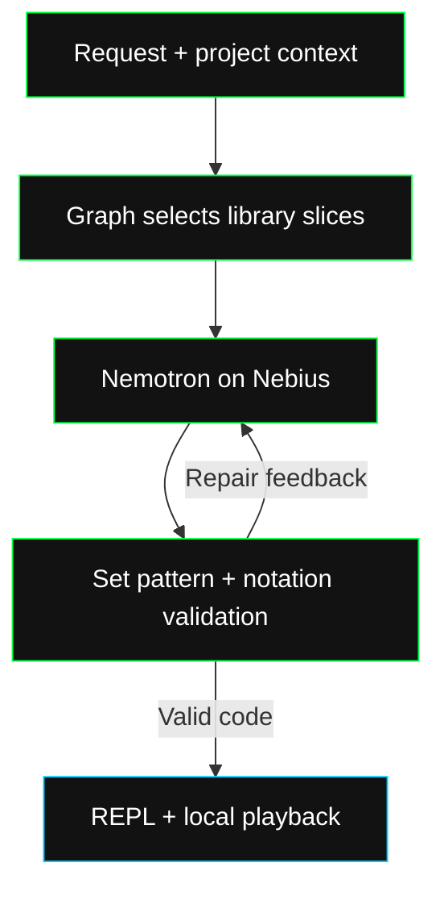

Algorithmic Composer writes a new Code part or transforms the pattern already in the REPL. It receives your request with the project's BPM, key, meter, reference track, selection or playhead, stems, track state and extracted musical context.

<Frame caption="The current Code REPL shows the pattern, reference selector, sound controls and Composer log.">
  
</Frame>

## Route before calling the model

A directed graph chooses the intent, target layers, reference role, section energy and genre archetype. It mounts only the required library slices in the model context.

| Library | Musical material |
| --- | --- |
| Drums | Supported drum tokens and Euclidean rhythm cells. |
| Harmony | Key-specific bass roots, scale notes, seventh-chord voicings and four-bar progressions. |
| Synths | Oscillator choices and supported filter, gain, timing, pan, reverb and delay recipes. |
| Archetypes | Ten genre arrangements with reference cells transposed to the project key. |

The reference role shapes how the new part sits against drums, bass, vocals, keys or the master. Intro, verse, build, drop and breakdown sections supply different density and energy instructions.

A filter, timing or effects change to existing code takes a compact transform path. It keeps unrelated harmony and genre material out of the prompt.

## Compose, validate and repair

The ReAct loop uses streamed tool calls and at most three turns. Library-reader tools are available only for libraries that the graph has not already mounted. After a read, the agent removes that reader from subsequent turns.

`set_strudel_pattern` cleans the code, checks supported notation and emits a short musical rationale. Invalid notation returns repair feedback within the turn limit. Valid code streams to the client, which updates the REPL and starts playback at the project tempo.

## Keep response work small

Nebius Token Factory serves Nemotron-3-Ultra with thinking disabled, temperature 0.4 and a 900-token output budget per turn. Local graph routing and prepared musical cells reduce the material the model must generate. Streaming exposes graph, status, rationale and code as they arrive.

The [integration guide](/dev/guides/edit/strudel) covers requests and playback. The [graph endpoint](/dev/endpoints/strudel/graph) lets you inspect routing without generating a pattern.
