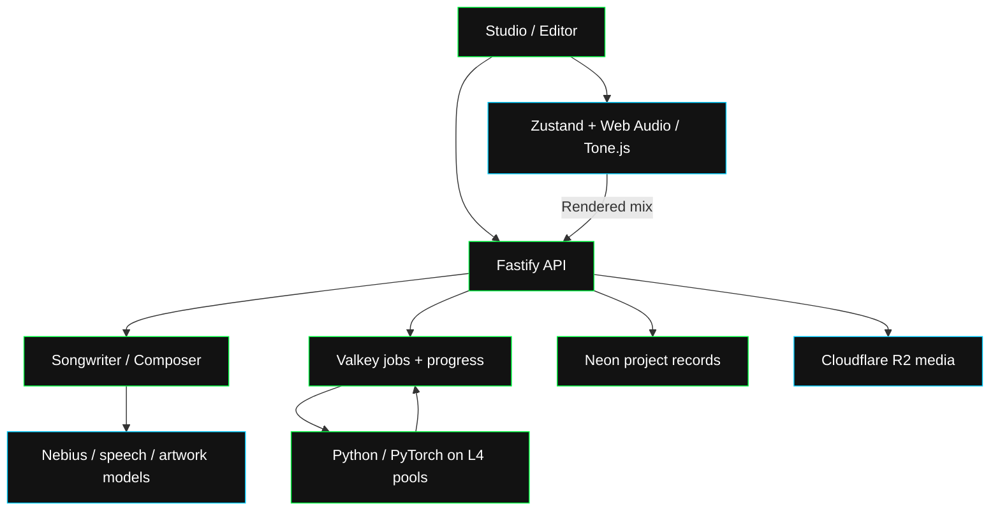

The browser handles interactive editing. Fastify handles requests and project records. Python workers run audio models on NVIDIA L4 GPUs. Hosted models prepare briefs, lyrics, patterns and artwork.

## Components

| Technology | Role in Rawchunks |
| --- | --- |
| React, TypeScript and Vite | Studio forms, Lyrics Canvas, library and Editor UI. |
| Zustand | Timeline, selection, track, mixer, instrument and Code state. |
| Tone.js and Web Audio | Schedule tracks and synthesized parts; process effects; render merged audio locally. |
| Strudel notation | Express rhythmic and pitched patterns. Rawchunks parses its supported notation and schedules it in the browser. |
| Node.js, Fastify and Zod | Serve REST and NDJSON, validate inputs, admit paid operations and coordinate results. |
| Python and PyTorch | Run ACE-Step conditioning, diffusion, waveform decoding, separation and voice training. |
| vLLM | Serve ACE-Step’s music language model alongside the audio pipeline. |
| TorchInductor and Triton | Compile PyTorch operations into GPU kernels. Compiler caches and warmups prepare the inference paths. |
| NVIDIA L4 | GPU compute for each audio-model or training replica. |
| Kubernetes on GKE and KEDA | Run separate model pools and adjust replicas from pending queue length. |
| Valkey | Durable jobs, executor leases, progress messages, WIP state and shared caches. |
| Neon PostgreSQL and Drizzle | Store accounts, songs, takes, stems, albums, history and Credits records. The API uses Neon's HTTP driver for project queries. |
| Cloudflare R2 | Store audio, artwork, voice samples and generated media. |
| Nebius Token Factory | Serve the Nemotron models used by both agents and image-brief interpretation. |
| Cartesia and ElevenLabs | Transcribe brief recordings and recover or align song lyrics. |
| Google Nano Banana | Generate cover artwork. |
| USDC sessions, x402 and Credits | Fund music operations and listening. [Payment interfaces](/dev/guides/payments). |
| Thirdweb and Swig | Connect EVM and Solana accounts for the app’s wallet workflows. [Account setup](/app/account). |
| IPFS and chain contracts/programs | Store mint metadata and record music ownership, licenses and royalties. [Publishing](/dev/guides/publish/mint). |

## Connections

Audio submissions return job IDs so the API can keep serving other requests. Progress reaches clients through NDJSON or status reads. Completed model output becomes a saved master, candidate take or set of stems.

[Concurrency](/ai-ml/concurrency) covers scheduling. [Inference](/ai-ml/inference) covers the work inside each GPU replica.
