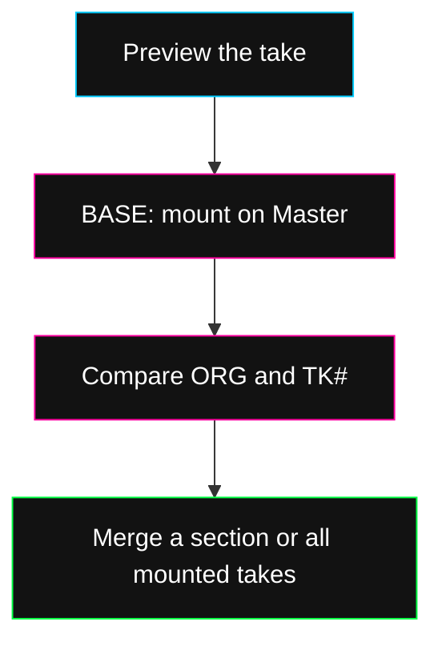

A **take** is a candidate from an edit or extraction. **BASE** mounts it on Master so you can hear and position it. **Merge** keeps the audible result in Master.

## Mount and compare

1. Expand the take group under **EXTRACTED**. Use the take's play button to hear it alone.
2. Select **BASE** to mount it. The button becomes a checkmark, and a **TK** overlay appears on Master.
3. Select the overlay. Drag it horizontally to change its position; use its reset arrow to return it to the original position.
4. Use **ORG** for the original audio underneath and **TK#** for the take. Turn each on or off to compare.

When a group has several takes, its numbered buttons choose the candidate. The expand arrow shows all takes in that group together.

<Frame caption="A mounted take and its comparison, merge, discard and reset controls in an example project.">
  
</Frame>

For an added layer, leave **ORG** and **TK#** on to hear both. For a replacement, turn **ORG** off in that region. The selected overlay's play button previews its section.

## Merge one section

Select the mounted overlay and use its merge checkmark. If you've selected a smaller range inside the take, only that portion is merged. The unused portion stays pending.

Listen with the intended original/take toggles before merging. A silenced take isn't included.

## Merge all mounted takes

Use the stacked-layer icon on the Master row, labeled **Merge all mounted sections**, to keep all audible mounted overlays.

This merges Master and its mounted takes. Ordinary lanes such as a separate Keys or Drums track are not automatically included just because you can hear them playing.

## Unmount or discard

Select the take's mounted checkmark again to unmount it while keeping the candidate. Use the trash control to discard a take you don't want.

**SET AS BASE** in **HISTORY** mounts the take too. Mounting alone does not replace the saved Master audio.

When **RESTORE MIX** appears in the board transport, it switches Master back to the available original generation take. It does not restore an earlier full arrangement or snapshot.
