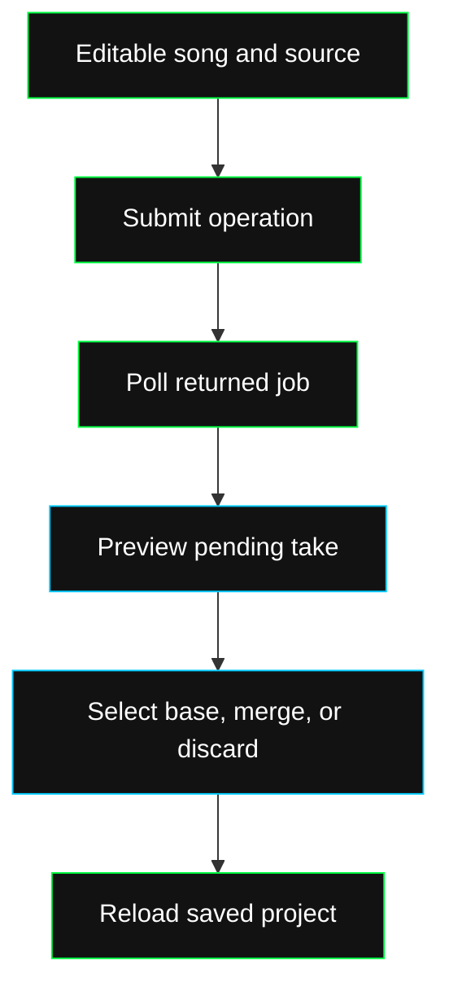

Editing starts from an existing song with audio. Load its project or [history](/dev/endpoints/editing/history), then submit a source and operation. Your session account must own the project.

For a minted song, first call `POST /api/songs/{id}/version` and use the returned draft ID. Audio changes to the original return 409.

## Operations

| Operation | Endpoint | Task returned for polling | Result |
| --- | --- | --- | --- |
| Rework a section | `/api/editing/repaint` | `repaint` | Pending replacement take |
| Add an instrument | `/api/editing/layer` | `lego` | Pending layer take |
| Generate accompaniment | `/api/editing/apply` with `complete` | `complete` | Pending take |
| Continue past the ending | `/api/editing/extend` | `extend` | Pending longer take |
| Change the audio style | `/api/editing/remix` | `cover` | Pending restyled take |
| Separate instruments | `/api/editing/separate` | `extract` | Stems, initially muted |
| Slice a source interval | `/api/editing/extract` | No job polling | Inactive section take |

`POST /api/editing/apply` supports all six model task kinds and forwards seed, BPM, key and language controls. The Rework, Layer and Restyle shortcuts do not forward those four fields. Use `/apply` when you need them.

## Source and model selection

Omit `stemId` to edit the master, or pass a stem from this song. Supply `srcAudioUrl` to edit a rendered mix or another explicit source. Otherwise the current take or selected track audio is used.

Read `/api/options` for supported modes per task. `base` is the default editing model. Layer and Accompany require `base`; Rework, Extend and Restyle can use their listed modes. If you send both `modelQuality` and `modelVariant`, they must match.

## Candidate lifecycle

A completed candidate does not silently replace the active arrangement. [Select or merge it](/dev/guides/edit/takes) after preview. Your product renders multi-take compositions; the API stores the uploaded result and history.
