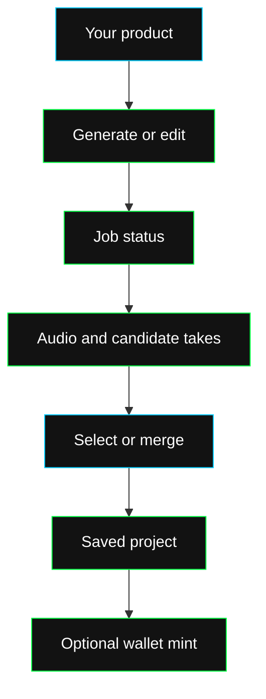

Rawchunks exposes the music operations used by its browser workstation. Your product can generate a track, replace a section, add an instrument, extend or restyle audio, separate stems, and manage the resulting takes.

The same project can keep a voice reference, edit history, artwork, and selling terms. Minting and license purchases use chain contracts with the user's wallet.

## Capabilities

| Your product needs to… | Integration |
| --- | --- |
| Fill a musical draft from text, image or audio | [Songwriter](/dev/guides/generate/vibe) |
| Compose or transform Code parts | [Algorithmic Composer](/dev/guides/edit/strudel) |
| Create vocal or instrumental music | [Generate music](/dev/guides/generate/music) |
| Supply lyrics, tempo, duration and key | [Lyrics and controls](/dev/guides/generate/lyrics) |
| Reuse a vocal recording or a prepared voice | [Saved voices](/dev/guides/generate/voices) |
| Change audio without regenerating the whole project | [Editing operations](/dev/guides/edit/overview) |
| Compare candidates and persist the chosen result | [Takes and activation](/dev/guides/edit/takes) |
| Combine sections or add your own rendered instruments | [Render and merge](/dev/guides/edit/merge) |
| Manage projects and albums | [Library integration](/dev/guides/library) |
| Publish an original or a licensed variation | [Minting](/dev/guides/publish/mint) and [licenses](/dev/guides/publish/licenses) |

## Project workflow

You can use the music APIs without embedding the Rawchunks UI. Your player and editor decide how to preview, arrange and render the returned audio.

Rawchunks combines generation and editing with saved projects, reusable voices and onchain licensing. Use the operations your product needs.

[Set up requests](/dev/guides/connect), then [generate your first track](/dev/guides/generate/music). The [endpoint reference](/dev/endpoints/overview) lists the public contracts.

The [AI/ML section](/ai-ml/overview) explains the stack, models, agents, concurrency and inference.
