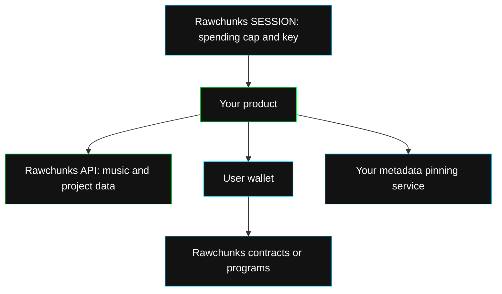

You call a JSON REST API over HTTPS. Audio uploads use multipart requests. Generation and voice progress can use NDJSON; edits use status polling. You do not need Rawchunks' frontend framework to use these interfaces.

## Stack

| Part | Technology | What it means for your integration |
| --- | --- | --- |
| Browser workstation | React, TypeScript and Vite | Use your own UI or study the open-source app as an integration example. |
| Audio editing and playback | Web Audio and Tone.js | Arrangement playback, keys, drums, live code and effects run in the client. Render audio before passing a mix to the API. |
| Public API | Node.js, Fastify and Zod | JSON requests, validated inputs, explicit status responses and multipart uploads. |
| Music generation and edits | ACE-Step 1.5 models | Select supported modes and operations from the [options endpoint](/dev/endpoints/system/options). |
| Project records | PostgreSQL and Drizzle | Songs, stems, takes, albums and history retain their IDs across your workflow. |
| Media and metadata | Object storage; IPFS for minted metadata | Use returned audio URLs. Pin the final metadata before a wallet mint. |
| Service payments | Rawchunks sessions and x402 | Create a session in Rawchunks and send its token to paid REST routes. |
| Onchain music | Solidity contracts on EVM; Rust programs on Solana | Sign, confirm and verify chain operations separately from REST updates. |

## Where each call goes

REST acceptance, playable audio, payment settlement, and a confirmed chain transaction are separate results. A saved `chain_song_id` is a catalog link, not a chain receipt.

## Portable IDs and data

Song, stem, take and voice IDs are opaque strings. Store them as returned. Chain song IDs are decimal strings; convert them to `bigint` when calling a contract. Durations and timeline bounds use seconds. Onchain prices and session budgets use six-decimal USDC atomic units.

New music is private in the catalog. That setting does not encrypt its media URLs. Your product should authenticate users, protect session tokens, and enforce access to its own project UI.
