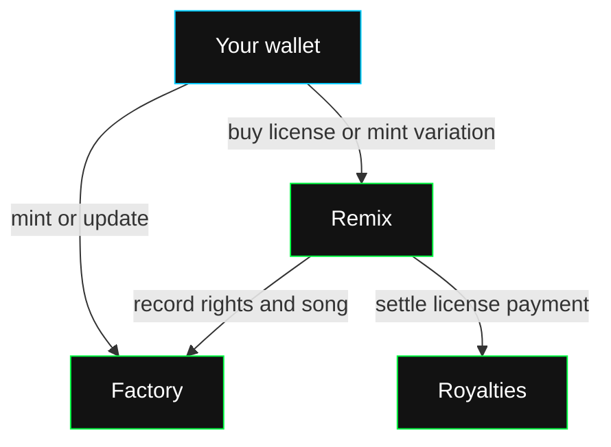

The EVM interface consists of three contracts:

| Contract | What you call it for |
| --- | --- |
| [Factory](/web3/contracts/factory) | Mint originals, read song terms and license rights, update your song, use ERC-721 ownership and transfers. |
| [Remix](/web3/contracts/remix) | Buy a license, mint a licensed variation and read variation IDs. |
| [Royalties](/web3/contracts/royalties) | Read the settlement token and the 80/20 license-payment split. |

Factory mints **Rawchunks Song** tokens (`RCSONG`). Token ownership, the recorded creator and purchased license rights are separate. Transferring an ERC-721 token does not change its recorded creator or move a buyer's license rights.

## Start an integration

1. Choose a deployment from [deployed contracts](/web3/contracts/deployed-contracts).
2. Connect a read client and wallet using [the contracts stack](/web3/contracts/stack).
3. Read the song's creator, metadata URI, prices and remix status before requesting a transaction.
4. Save the submitted transaction hash and confirm its receipt before recording the result in your product.

Metadata lives at the song's URI. The contracts store its reference and selling terms. Use the [publishing walkthrough](/dev/guides/publish/mint) for the full music and metadata workflow.
