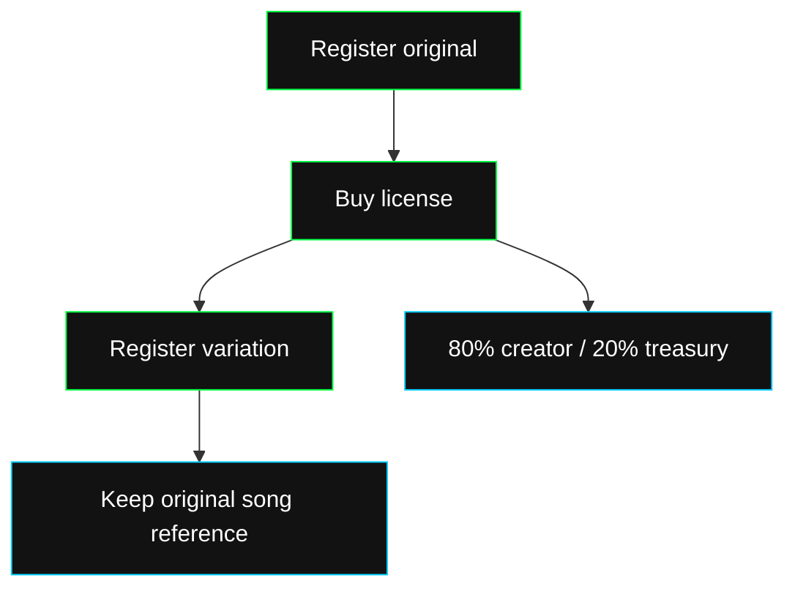

Rawchunks gives your project public chain interfaces for song registration, license purchases and remix provenance. Choose the EVM contracts or Solana programs for your integration.

| You want to | Use |
| --- | --- |
| Register an original with a creator, metadata URI and prices | Factory |
| Buy an ongoing license for an original | Remix |
| Register a licensed variation and its original song ID | Remix |
| Read how a license payment is split | Royalties |
| Change your song's prices or metadata URI | Factory, signed by the creator |

One purchased license can support several variations. Each variation references an original; variations cannot be licensed for further remixing.

## Choose your chain

<Columns cols={2}>
  <Card title="Contracts" icon="file-code" href="/web3/contracts/overview">
    Solidity interfaces, ERC-721 song tokens, Foundry and EVM deployments.
  </Card>
  <Card title="Programs" icon="code" href="/web3/programs/overview">
    Solana instructions, song accounts, Pinocchio and program IDs.
  </Card>
</Columns>

Song IDs belong to one network and Factory deployment. Store the network, Factory address or program ID, and song ID together.

Chain transactions use your wallet's signer and network fees. Rawchunks API calls use your [Rawchunks session](/dev/guides/connect). To generate, edit, pin metadata and publish a song in your product, follow the [mint guide](/dev/guides/publish/mint).
