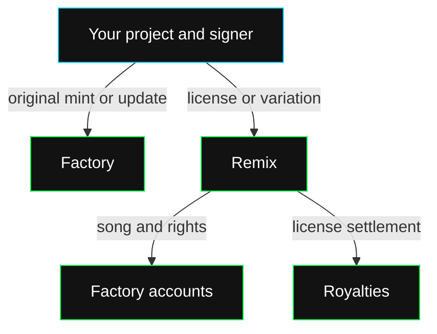

The Solana interface consists of three Pinocchio programs:

| Program | What you use it for |
| --- | --- |
| [Factory](/web3/programs/factory) | Register originals, read songs and license records, update your song's prices or metadata. |
| [Remix](/web3/programs/remix) | Purchase ongoing rights, register licensed variations and read variation records. |
| [Royalties](/web3/programs/royalties) | Settle a license payment using the configured token mint and 80/20 split. |

Factory stores songs in program-owned accounts. These instructions do not create an SPL token or Metaplex NFT. The public interface has no song-transfer instruction; the recorded creator signs song updates.

## Start an integration

1. Check [deployed programs](/web3/programs/deployed-programs) for program IDs and current availability.
2. Use [the programs stack](/web3/programs/stack) to connect RPC, subscriptions and your Solana signer.
3. Use the provided builders or match the documented instruction bytes and account order.
4. Confirm the transaction, then read the resulting account and verify its owner, song ID, creator and metadata URI.

Reads use Solana RPC. Writes require a transaction signer with enough SOL for fees and account rent. Priced licenses also require the configured settlement token.

[Account reference](/web3/programs/accounts) · [Solana publishing walkthrough](/dev/guides/publish/solana)
